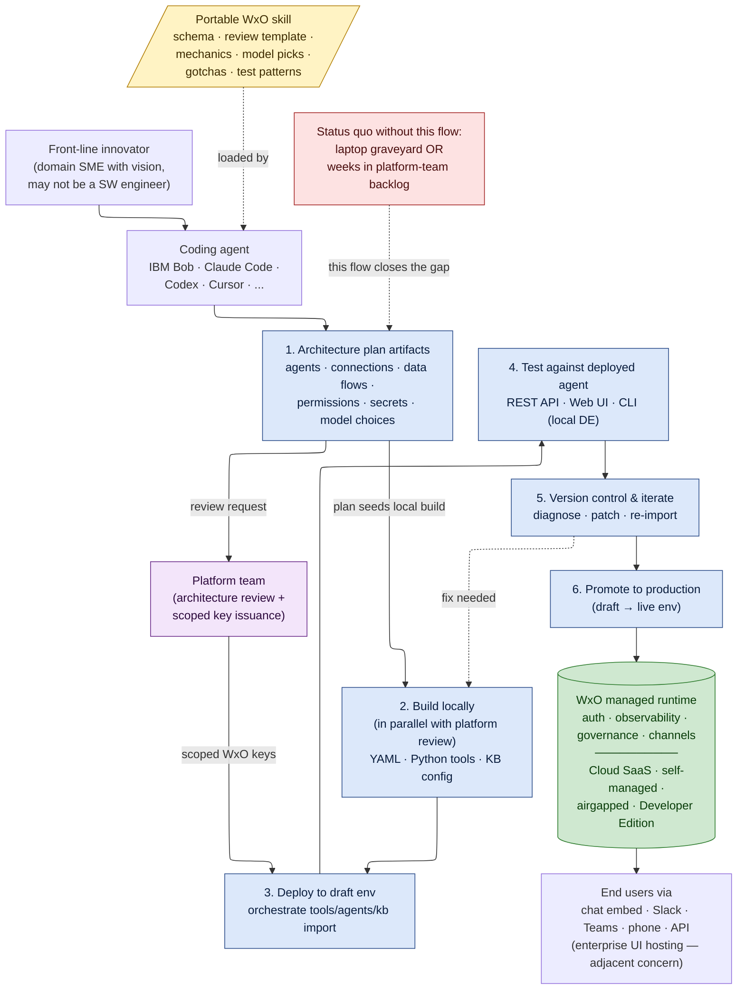

<!-- Copyright contributors to the Agentic AI Labs project -->
<!-- SPDX-License-Identifier: Apache-2.0 -->
<!-- This file was authored with the assistance of AI Tool: Claude Code (Claude Opus) -->

# Coding Agent → watsonx Orchestrate
### A portable, governed path from local prototype to managed runtime

This document maps the workflow the `wxo-agent-architect` skill guides you
through: how a **front-line innovator** — a domain SME with a vision who may
not be a software engineer — takes an agent from a blank file to running on
watsonx Orchestrate (WxO) under enterprise governance, working in whatever
coding-agent ecosystem they already use (IBM Bob, Claude Code, OpenAI Codex,
Cursor, etc.). It is written for the innovators who follow the flow and the
platform teams who review and approve at the gate.

---

## The problem this solves

Modern coding agents let domain experts execute on their own ideas without
relying on a software-engineering team to translate. But the agents they
build typically end up in one of two dead ends:

- **Laptop graveyard.** The agent runs locally with no auth, no
  observability, no governance. It never reaches the people it was built for.
- **Platform-team queue.** The agent is handed to a central team for
  "productionization" and waits weeks behind a backlog before anyone can
  deploy it.

Neither outcome respects the speed at which modern coding agents let
front-line innovators build, and neither gives the platform team confidence
that what gets deployed meets the enterprise bar.

## How this flow closes the gap

The skill encodes everything a coding agent needs to drive WxO end to end,
*with a deliberate architecture-review gate in the middle so the platform team
retains oversight without becoming a bottleneck*. You keep your preferred
coding agent. The same coding agent that helped you build the agent also
generates the review artifacts, deploys, tests, and iterates on managed
infrastructure.

---

## Process diagram

---

## How to read the diagram

Identifying components by **label and color** (renderer-independent):

- **Front-line innovator** (top node, unstyled): the human with the vision.
- **Coding agent** (top node, unstyled): IBM Bob, Claude Code, Codex,
  Cursor, etc. — whatever you prefer.
- **Portable WxO skill** (yellow trapezoid): the knowledge artifact loaded
  into the coding agent. Independent of which coding agent is used.
- **Platform team** (purple): the review-and-issue-keys gate. Not a delay
  vehicle — a fast review of pre-structured artifacts.
- **Six numbered blue phases**: the pipeline you follow. Phase 1
  (architecture plan) is the **fork point**: its output feeds the platform
  team's review AND seeds the local build in parallel. Phase 3 (Deploy) is
  the **join point**: it requires both the built artifacts (from phase 2)
  and the scoped keys (from the platform team).
- **WxO managed runtime** (green cylinder): the destination. Same flow
  targets Cloud SaaS, self-managed, airgapped, or the local Developer
  Edition — the build/test loop is identical, only the WxO endpoint changes.
- **Status quo** (red): the two failure modes this flow eliminates.

---

## Phase-by-phase walkthrough

### 1. Architecture plan artifacts
Describe your goal in natural language. The coding agent, equipped with the
WxO skill, drafts a structured architecture plan (using
`architecture_plan_template.md`): agents to deploy, collaborator graph,
external integrations, connections and secrets needed, knowledge bases, model
selections (with reasoning), data-sensitivity classification, expected
channels, load estimate, and token/cost estimate. These artifacts go to the
platform team for a fast review and key-scoping decision. The standardized
structure is what makes that review hours, not weeks.

### 2. Build locally (parallel)
While the platform team reviews, you do not wait. The coding agent generates
the agent YAML, Python tools, and knowledge-base configs against the same
plan the platform team is reviewing. If review surfaces architectural
changes, the local build absorbs them before deployment.

### 3. Deploy to draft env
Once the platform team issues scoped WxO API keys (`WO_API_KEY` +
`WO_INSTANCE` for your specific tenant and environment), the coding agent
runs the orchestrate ADK CLI directly: `orchestrate tools import`,
`orchestrate agents import`, `orchestrate knowledge-bases import`. Resources
land in the WxO **draft** environment of the tenant.

### 4. Test against the deployed agent
The coding agent exercises the agent against realistic prompts:
- **REST API** — scriptable, perfect for CI and regression suites.
- **Web UI** — visual, non-scriptable, best for human-in-the-loop validation.
- **CLI** — local Developer Edition only.

Testing against the *deployed* agent matters because routing, delegation,
memory, and tool-call behavior cannot be predicted reliably from YAML
inspection alone — and several runtime gotchas only surface here (e.g.,
specific models silently ignoring agent styles).

### 5. Version control & iterate
The skill carries a diagnostic checklist of the most common runtime gotchas.
Patch the YAML or tool code, commit to version control, and re-import under
the same names — which preserves the WxO agent ID and channel bindings —
then re-run the same test prompts for direct A/B.

### 6. Promote to production
When testing in draft passes, promote to the **live** environment. WxO
handles the version cutover; existing channel bindings remain intact.

---

## Why WxO is the right destination

When the agent lands on WxO it inherits, without you writing any of it
yourself:

- **Auth and identity** — IAM-backed; customer SSO when configured.
- **Observability** — traces, run history, evaluations, latency profiles.
- **Governance** — draft vs live environments, role-based access, version
  control of agent definitions, eval gates between draft and live.
- **Channels** — web chat embed, Slack, Teams, Twilio, phone — turn-key
  per agent.

These are the four things a laptop-bound agent will never give you on its
own, and the four things a central platform team usually spends weeks wiring
up by hand. WxO supports the same managed-runtime contract across deployment
topologies — public Cloud SaaS, self-managed on customer infrastructure,
airgapped installations, and the local Developer Edition for prototyping. The
skill and the flow above are identical across all of them.

---

## Adjacent concerns deliberately out of scope

These are real needs but **do not belong inside the WxO deployment skill**.
Each is its own concern, typically with its own ecosystem-specific answer:

- **Enterprise UI hosting.** WxO ships a chat surface and channel embeds
  (web chat, Slack, Teams, phone), but most enterprises will want a richer
  front-end hosted in their existing app or portal. The right approach varies
  per ecosystem (existing web framework, identity model, design system), so
  it is handled separately from this skill.
- **Model gateway and FinOps controls.** Token budgets, per-tenant model
  policies, cost reporting — handled at the WxO model-gateway layer,
  configured by the platform team, not inside an individual agent's YAML.
- **Cross-system data residency and DLP.** Sensitive-data routing belongs to
  the customer's data-platform team and is reflected in phase 1's data-flow
  disclosure, but is not authored inside this skill.
